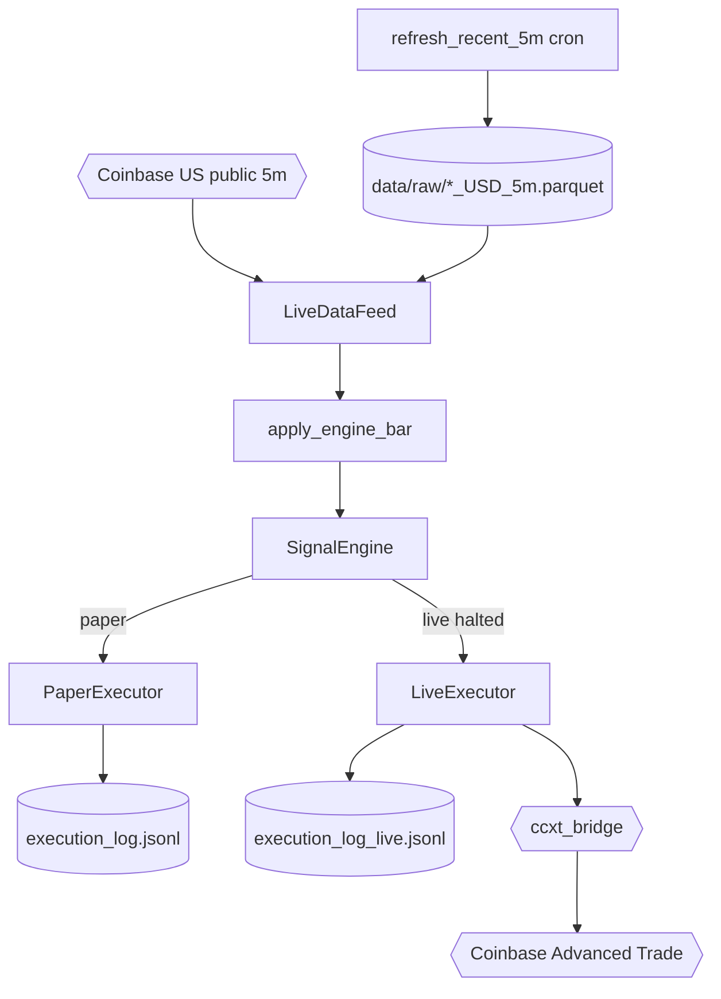

# Architecture

[Wiki](README.md) · [Index](INDEX.md) · [Getting started](getting-started.md) · [Setup](diagrams/setup.md)

The host is a thin Python process. It does **not** attach a Nautilus `LiveNode`, `TrendRotationV2Strategy`, or `native_exec_bridge`. Those files sit in `archive/thin_host_nautilus/` and are not imported.

Data enters as Coinbase public 5m candles (parquet at boot, REST after). Closed 4h bars (8pm / midnight / 4am / 8am / noon / 4pm ET) go through `apply_engine_bar` → `SignalEngine` → a journaled executor. Paper never loads API keys. LIVE is the same wiring with `LiveExecutor` + `ccxt_bridge`, and is **halted** until a new `data/LIVE_APPROVED`.

The short book (`short/`) does not share this engine, journal, or the live sleeve portfolio. CFM long research is `cfm/` (not this engine, not a rotation port). An isolated **paper soak** for `donch_d20_10` runs on a daily clock (`paper_family_node.py`); it is **not** SSOT and does not share the 4h journal. See [DONCH_PAPER.md](DONCH_PAPER.md).

## Components

- **live_node** — mode gates, lock, seed, health, 4h callback. See [modules/live-node.md](modules/live-node.md).
- **LiveDataFeed** — public REST 5m fold; only emits completed 4h buckets.
- **SignalEngine** — decision SSOT. See [modules/signal-engine.md](modules/signal-engine.md).
- **PaperExecutor / LiveExecutor** — sizing, fees, risk, journal. See [modules/executors.md](modules/executors.md).
- **research_replay** — same engine + CASH paper, no clock. See [modules/research-replay.md](modules/research-replay.md).
- **viz** — read-only projector + static site. Journals/health/rollups → `viz/snapshots/`. Not on the money heap. See [../viz/README.md](../viz/README.md).

## System diagram

Orchestrator: `strategies/live_node.py`  
Paper unit: `deploy/pro-trader-paper.service` → `config/live_paper.json`  
Donch paper soak (not SSOT): `deploy/pro-trader-paper-donch.service` → `config/live_paper_donch.json`  
LIVE unit: **inactive**. Needs a new `LIVE_APPROVED`.

## Mode matrix

| Mode | Executor | Journal | Real orders | Gates |
|---|---|---|---|---|
| PAPER | `PaperExecutor` | `data/execution_log.jsonl` | No | None (SIMULATION default) |
| LIVE | `LiveExecutor` | `execution_log_live.jsonl` | Yes | `LIVE_TRADING=true`, `SIMULATION_MODE=false`, `data/LIVE_APPROVED`, `COINBASE_PORTFOLIO_ID`, keys |

Dry-run `LiveExecutor` remains in unit tests only. There is no node mode for it.

## Data flow

1. **Boot seed** — last ~15k 5m rows → 4h → `engine.on_bar(..., emit=False)` — [`live_data_feed.py`](../strategies/live_data_feed.py)
2. **Journal restore + slot sync** — [`paper_executor.py`](../strategies/paper_executor.py) / [`live_executor.py`](../strategies/live_executor.py)
3. **LIVE only: reconcile** — [`live_reconcile.py`](../strategies/live_reconcile.py). Boot, each 4h wave, **before every BUY**, and **before every CLOSE**. Healthy fetch is venue SSOT: extra USD → `CASH_DEPOSIT`, missing USD → `CASH_WITHDRAW`, lot drift → `BOOK_SYNC`. Wallet `available_balance` overlays rounded portfolio crypto lots. Failed fetch does not adopt. Clip = `equity × max_alloc_pct` (0.25). Dollar clip/book caps are off (`0`). Daily halt is **10%** of day-start equity. `min_notional_usd=5` only. **LIVE orders:** IOC limit at ask after spread/chase gates (`buy_protect`); no unbounded market buy. Close never sells above wallet available.
4. **Poll 5m, emit closed 4h** — [`live_data_feed.py`](../strategies/live_data_feed.py)
5. **Apply** — [`bar_apply.py`](../strategies/bar_apply.py) → engine → executor
6. **Health** — `data/node_health.json` (+ `_live` twin when LIVE is on)

## SSOT

| Concern | Source |
|---|---|
| Entry / exit / rotation | `strategies/signal_engine.py` |
| Production knobs | `config/trend_rotation_25_max8_rotate.json` |
| What paper runs | `config/live_paper.json` (`_include` DNA) |
| Symbols | `config/universe_live.json` via `strategies/universe.py` |
| Paper / live book | `data/execution_log.jsonl` / `execution_log_live.jsonl` |
| Live MTM display | `data/node_health.json` → `equity` |
| Pre-trade risk | `risk_limits.py` + overlay `risk` block |
| Halt | `data/TRADING_HALTED` or `TRADING_HALTED_{paper,live}` |
| Order I/O | `ccxt_bridge.py` only (`native_v2` refused) |

## Key design decisions

- **One brain, two clocks.** Live uses REST 4h close; research uses parquet fold. Same `SignalEngine`.
- **Executors own money.** Engine emits `{type, symbol, reason}`; sizing/fees/halt live in the executor.
- **Rotation ≠ `max_concurrent`.** Need `rotate_when_full` + min-hold + underwater-only + `_long_slots`.
- **CASH only** for production research. Rejected: defensive max4 stack, hybrid LS as main DNA.
- **Root modules stay put.** `live_node` imports `risk_limits` and `ccxt_bridge` from repo root.
